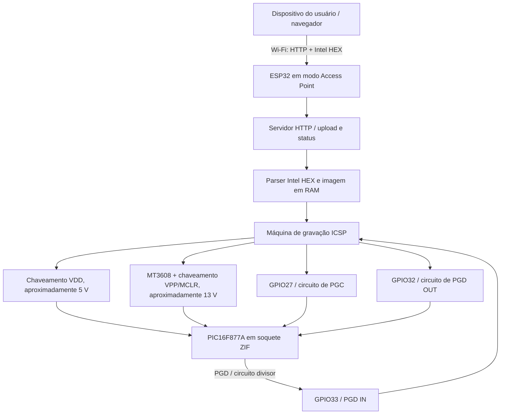
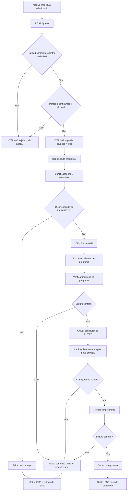

# Gravador ICSP via Wi-Fi com ESP32 para o PIC16F877A

**Documentação técnica do firmware, do protocolo, da arquitetura elétrica e do procedimento experimental**

> **Projeto acadêmico — Trabalho de Conclusão de Curso em Engenharia de Computação, Universidade Estadual de Ponta Grossa (UEPG), 2026.**  
> **Autores do TCC:** Diogo Leal da Silva e Rafael Zachesky de Oliveira.  
> **Orientação:** Prof. Dr. Jonathan de Matos.  
> **Revisão do firmware documentada:** 22/10/2026, conforme cabeçalho do arquivo `Gravador_WiFi_PIC.ino`.  
> **Escopo comprovado no TCC:** validação inicial com o **PIC16F877A**. O nome da família PIC16F87xA expressa o contexto técnico e a possibilidade de expansão, **não** o suporte experimentalmente demonstrado a todos os seus integrantes.

**Repositório:** <https://github.com/Darthpool9900/gravador-pic>  
**Firmware analisado:** [`Gravador_WiFi_PIC.ino`](./Gravador_WiFi_PIC.ino)  
**Base documental:** TCC *Desenvolvimento de um programador ICSP via Wi-Fi baseado em ESP32 para microcontroladores da família PIC16F87xA*, documentação técnica da Microchip e código C++ disponibilizado no repositório.

---

## Sumário

1. [Visão geral](#1-visão-geral)
2. [Objetivo, escopo e limites da validação](#2-objetivo-escopo-e-limites-da-validação)
3. [Arquitetura física e lógica](#3-arquitetura-física-e-lógica)
4. [Materiais, alimentação e conexões](#4-materiais-alimentação-e-conexões)
5. [Fundamentos do ICSP e escolha de VPP em 13 V](#5-fundamentos-do-icsp-e-escolha-de-vpp-em-13-v)
6. [Estrutura do firmware e organização de memória](#6-estrutura-do-firmware-e-organização-de-memória)
7. [Descrição aprofundada das funções](#7-descrição-aprofundada-das-funções)
8. [Interpretação rigorosa do arquivo Intel HEX](#8-interpretação-rigorosa-do-arquivo-intel-hex)
9. [Protocolo ICSP: comandos, quadros e temporização](#9-protocolo-icsp-comandos-quadros-e-temporização)
10. [Sequência completa de gravação, leitura e verificação](#10-sequência-completa-de-gravação-leitura-e-verificação)
11. [Servidor HTTP, interface web e estados da operação](#11-servidor-http-interface-web-e-estados-da-operação)
12. [Inicialização e execução do firmware](#12-inicialização-e-execução-do-firmware)
13. [Instalação e operação do protótipo](#13-instalação-e-operação-do-protótipo)
14. [Ensaios do TCC e evidências experimentais](#14-ensaios-do-tcc-e-evidências-experimentais)
15. [Desempenho e análise temporal](#15-desempenho-e-análise-temporal)
16. [Tratamento de falhas, proteções e limitações](#16-tratamento-de-falhas-proteções-e-limitações)
17. [Rastreabilidade, testes e reprodução científica](#17-rastreabilidade-testes-e-reprodução-científica)
18. [Possíveis extensões da pesquisa](#18-possíveis-extensões-da-pesquisa)
19. [Glossário](#19-glossário)
20. [Referências técnicas e acadêmicas](#20-referências-técnicas-e-acadêmicas)

---

## 1. Visão geral

O projeto desenvolve um **programador de microcontrolador PIC acessível por Wi-Fi**, no qual um **ESP32** controla, por firmware próprio, os sinais da interface **ICSP (*In-Circuit Serial Programming*)** do **PIC16F877A**. Um navegador conectado ao ponto de acesso local disponibilizado pelo ESP32 envia um arquivo **Intel HEX**. O arquivo é interpretado, validado e convertido em uma imagem de palavras de memória. Só então o firmware verifica a identificação do PIC, inicia o apagamento e a escrita, grava a palavra de configuração e realiza leituras para detectar divergências.

O caminho de dados é:

```text
Arquivo Intel HEX no dispositivo do usuário
                    │
                    ▼
         Navegador (HTTP local)
                    │
                    ▼
     Ponto de acesso Wi-Fi do ESP32
                    │
                    ▼
            Servidor WebServer
                    │
                    ▼
       Validação do Intel HEX na RAM
                    │
                    ▼
      Controle de VDD / VPP / PGC / PGD
                    │
                    ▼
   Interface elétrica de adaptação de níveis
                    │
                    ▼
        PIC16F877A (memória Flash)
                    │
                    ▼
       Releitura e comparação de dados
                    │
                    ▼
     Estado consultável em GET /status
```

A rede sem fio **transporta o arquivo até o ESP32**. A comunicação entre **ESP32 e PIC é elétrica, por linhas ICSP**; o PIC não dispõe de Wi-Fi neste projeto. O ESP32 é simultaneamente o servidor de arquivos, o interpretador do Intel HEX e o controlador da sequência de gravação. O navegador não executa o protocolo ICSP diretamente.

### 1.1 Diferenciais técnicos efetivamente implementados

- Envio de arquivo `.hex` por página local do ESP32, sem necessidade de Internet ou de computador conectado por USB ao gravador durante a operação.
- Geração de comandos ICSP por GPIO, em software (*bit banging*), sem periférico SPI dedicado na rotina apresentada.
- Alimentação `VDD` do alvo e tensão de entrada em programação `VPP/MCLR` com comandos independentes.
- Interfaces para `PGC` e `PGD` que realizam adaptação dos níveis entre a lógica do ESP32 e a do PIC.
- Identificação do dispositivo **antes do primeiro apagamento**; até três tentativas de identificação, sem repetição automática da operação destrutiva.
- Validação do Intel HEX, incluindo caracteres, comprimento, checksum, regiões permitidas e completude das palavras.
- Releitura completa da faixa usada do programa, leitura da configuração após nova entrada ICSP e nova verificação do programa após configurar o dispositivo.
- Feedback textual de status, tanto na interface web quanto no Monitor Serial.

### 1.2 O que o projeto **não** é

O firmware **não compila C ou C++ para PIC**, **não transforma código-fonte em HEX**, **não programa o PIC por rádio diretamente**, **não é um depurador**, **não implementa a EEPROM de dados**, **não oferece perfis selecionáveis de outros PICs**, **não incorpora gravação diferencial**, **não fornece garantia de segurança industrial** e **não foi validado para todos os microcontroladores PIC16F87xA**. Ele consome um **arquivo de máquina Intel HEX já preparado**.

## 2. Objetivo, escopo e limites da validação

### 2.1 Objetivo geral do TCC

Integrar a transmissão de um programa por uma interface Wi-Fi local ao processo de programação de um microcontrolador PIC, atendendo aos requisitos elétricos da entrada por alta tensão e às etapas do protocolo ICSP.

### 2.2 Objetivos específicos relacionados ao código

| Objetivo | Implementação correspondente |
|---|---|
| Comandar a interface elétrica | `VPP`, `VDD`, `PGC`, `PGD_OUT`, `PGD_IN`; `entrar()`, `sair()`, `pgc()`, `pgd()` |
| Receber um arquivo pela rede | `PAGINA`, `WebServer`, `receberArquivo()`, `pedidoGravacao()` |
| Validar conteúdo antes de apagar | `nibble()`, `analisarHex()`, máscaras `recebido[]` e `configRecebida` |
| Identificar o alvo | `selecionarConfig(6)`, `lerAtual()`, máscara `0x3FF0` |
| Apagar e escrever a Flash | `comando(0x1F)`, `gravarPalavra()` e avanço `0x06` |
| Gravar e verificar configuração | `selecionarConfig(7)`, `comando(0x08)`, leituras imediata e persistente |
| Confirmar a memória | `verificarPrograma()` antes e depois da configuração |
| Informar andamento | `informar()`, `atender()`, rota `/status` |

### 2.3 Delimitação de suporte

A implementação atual define `PALAVRAS = 8192`, testa o identificador do **PIC16F877A** e restringe a memória de programa aos endereços de palavra `0x0000` a `0x1FFF`. A palavra de configuração é lida/escrita na posição `0x2007`. Isso não significa que todos os dispositivos com pinagem ou comandos similares estejam suportados. Cada modelo requer revisão de capacidade, identificação, mapa, algoritmos, temporização e condições elétricas.

O TCC descreve um processo progressivo: simulação no Proteus, medições estáticas com multímetro, teste de identificação, escrita de uma palavra, teste com dezesseis padrões, envio de programas por Wi-Fi e observação de execução do LED no PIC. **Esses resultados pertencem aos ensaios relatados no trabalho**. O código publicado está identificado como revisão de **22/10/2026**, com esperas de inicialização específicas, e **não se presume uma nova rodada de medições instrumentadas após essa revisão**.

---

## 3. Arquitetura física e lógica

### 3.1 Diagrama de blocos



> Diagrama explicativo **derivado do código e da arquitetura do TCC**. Não substitui o esquemático do Proteus nem os fluxogramas originais apresentados na defesa.

### 3.2 Separação de responsabilidades

**Plano de rede:** página HTML, `fetch`, HTTP, recebimento multipart e estado textual.  
**Plano de dados:** parser Intel HEX, verificação de checksum, mapa de palavras e configuração.  
**Plano de controle:** autorização de início, sinalização `ocupado`, sequência de estados e tratamento de erro.  
**Plano físico:** comandos de GPIO, inversão dos estágios transistorizados, alimentação, clock e linha bidirecional PGD.

Essa separação é *conceitual*: a versão publicada implementa todos esses blocos em **um único arquivo `.ino`**. Não há módulos C++ separados, RTOS dedicado à gravação, fila de tarefas ou API distribuída no repositório analisado.

### 3.3 Por que controlar a alimentação do PIC?

A entrada por alta tensão requer uma transição controlada para o modo de programação. O código não apenas envia bits: ele primeiro estabelece estados seguros, comanda o fornecimento de VDD e aplica VPP conforme as esperas da revisão. Isso é necessário para que a leitura do ID e os comandos seguintes sejam interpretados pelo PIC na modalidade ICSP esperada.

---

## 4. Materiais, alimentação e conexões

### 4.1 Componentes principais descritos no TCC

| Elemento | Papel no sistema |
|---|---|
| ESP32 com módulo ESP32-WROOM-32UE | Controle do fluxo, rede Wi-Fi, servidor HTTP e geração dos sinais |
| PIC16F877A em DIP-40 | Microcontrolador alvo dos testes |
| Soquete ZIF de 40 pinos | Inserção e remoção do PIC durante ensaios, **sempre sem alimentação** |
| Fonte regulada de aproximadamente 5 V | Alimentação de referência dos blocos e do PIC via estágio chaveado |
| Conversor elevador MT3608 | Ajuste da tensão de VPP para aproximadamente 13 V |
| BS250, MOSFET de canal P | Chaveamento do ramo VPP/MCLR no protótipo físico |
| 2N3904, transistores NPN | Controle dos chaveamentos e dos sinais de coletor aberto |
| BC327, transistor PNP | Comutação positiva da alimentação VDD do PIC |
| Resistores, capacitores e interligações | Polarização, pull-up, descarga, divisão de tensão e desacoplamento |
| Placa perfurada / protoboard | Construção final e etapas preliminares, respectivamente |
| Multímetro | Medição de tensões **estáveis** nos ensaios documentados |

O TCC distingue **BS250 no circuito físico** e **2SJ50 no modelo de simulação**. Essa equivalência é funcional na demonstração do chaveamento, **não** uma afirmação de que os componentes sejam intercambiáveis em pinagem ou especificações.

### 4.2 GPIOs efetivamente usados

| Constante C++ | GPIO do ESP32 | Direção do GPIO | Estágio / finalidade |
|---|---:|---|---|
| `VPP` | 25 | Saída | Habilita o estágio NPN + MOSFET P que aplica aproximadamente 13 V a MCLR/VPP |
| `VDD` | 26 | Saída | Habilita o estágio NPN + BC327 de alimentação do alvo |
| `PGC` | 27 | Saída | Aciona o transistor inversor do clock de programação |
| `PGD_OUT` | 32 | Saída | Aciona o transistor inversor de escrita em PGD |
| `PGD_IN` | 33 | Entrada | Lê PGD **após** divisor resistivo; não recebe 5 V diretamente |

O programa contém:

```cpp
constexpr uint8_t VPP = 25;
constexpr uint8_t VDD = 26;
constexpr uint8_t PGC = 27;
constexpr uint8_t PGD_OUT = 32;
constexpr uint8_t PGD_IN = 33;
```

Esses GPIOs são a interface de controle do **hardware específico descrito no TCC**. Mudar a placa, o circuito inversor ou o mapeamento exige atualizar e testar tanto o esquema quanto o firmware.

### 4.3 Pinagem ICSP no PIC16F877A DIP-40

| Pino físico PIC | Sinal | Origem no protótipo |
|---:|---|---|
| 1 | `MCLR/VPP` | Chave de alta tensão controlada por GPIO25 |
| 11 e 32 | `VDD` | Alimentação chaveada do alvo |
| 12 e 31 | `VSS` | Terra comum de referência |
| 36 | `RB3/PGM` | Mantido em nível baixo por polarização de acordo com o circuito descrito |
| 39 | `RB6/PGC` | Saída de relógio condicionada, controlada por GPIO27 |
| 40 | `RB7/PGD` | Barramento bidirecional ligado ao circuito de saída/entrada PGD |

> **Atenção:** números da tabela são do encapsulamento DIP-40 do **PIC16F877A**. Eles não servem como instrução universal de ligação para encapsulamentos ou modelos diferentes.

### 4.4 Níveis elétricos e circuitos de adaptação

O ESP32 trabalha com **GPIO de aproximadamente 3,3 V**. O PIC, na montagem documentada, utiliza **VDD próximo de 5 V**. VPP é uma terceira tensão, maior, aplicada somente a MCLR/VPP para selecionar a entrada de programação por alta tensão.

- **VPP:** MT3608 ajustado para aproximadamente `13 V`; chaveamento com MOSFET P e NPN. Não existe aplicação direta dessa tensão em GPIO do ESP32.
- **VDD:** 5 V com controle no lado positivo pelo BC327, comandado por NPN.
- **PGC:** pull-up do lado PIC e NPN que força o nível baixo; a saída física **inverte** a lógica do GPIO27.
- **PGD OUT:** NPN em coletor aberto e pull-up do lado PIC; a saída física **inverte** o estado do GPIO32.
- **PGD IN:** divisor resistivo entre PGD do PIC e GPIO33; limita o nível alto que chega ao ESP32.

No divisor final descrito no TCC, `Rsuperior = 14,7 kΩ` e `Rinferior = 20 kΩ`:

$$
V_{PGD\_IN}=V_{PGD\_PIC}\frac{20}{14,7+20}.
$$

Para `VPGD_PIC = 5,4 V`, o cálculo ideal resulta em aproximadamente **3,11 V**. Essa é uma previsão de divisor sem considerar todos os carregamentos e tolerâncias. O TCC distingue fotografias do divisor inicial (com valores diferentes) do ajuste posterior.

O uso de valores numéricos **nesta explicação técnica** não altera a convenção visual adotada nas figuras revisadas do TCC, que identificam resistores no circuito por `R1`, `R2`, etc.

### 4.5 Precauções de alimentação e manuseio

1. Ajuste a saída do MT3608 **sem o PIC conectado** e confira a polaridade com multímetro.
2. Respeite a faixa de programação do dispositivo; a especificação de entrada HVP indica `13 V ± 0,5 V` em MCLR/VPP.
3. Mantenha GND comum aos módulos que compartilham sinais lógicos.
4. **Nunca** conecte PGD de aproximadamente 5 V, VPP de aproximadamente 13 V ou a alimentação de 5 V diretamente a um GPIO de 3,3 V do ESP32.
5. Evite unir indevidamente os positivos de uma alimentação USB e de uma fonte externa. A montagem do ensaio web documenta ESP32 em USB e blocos em fonte externa, com terras comuns e sem ligar os positivos entre si.
6. Insira ou retire o PIC do ZIF somente com **todas as alimentações externas removidas e as tensões verificadas**. Comando `digitalWrite(..., LOW)` **não substitui isolamento físico nem medição**.
7. A fonte nominal de 5 V do ensaio apresentou valores próximos de 5,4 V. A faixa admissível deve ser avaliada **no pino VDD do PIC, sob carga**, e não presumida a partir da tensão nominal da fonte.

---

## 5. Fundamentos do ICSP e escolha de VPP em 13 V

### 5.1 O que é ICSP

ICSP é o mecanismo serial de gravação e verificação em circuito utilizado pelo dispositivo da família estudada. Durante a programação, `RB6/PGC` recebe clock e `RB7/PGD` transporta comandos e dados em ambos os sentidos. `VDD` e `VSS` alimentam o dispositivo; `MCLR/VPP` participa da entrada em modo de programação.

### 5.2 Alta tensão (HVP) versus baixa tensão (LVP)

A família PIC16F87xA documenta duas formas de entrada:

- **HVP (*High-Voltage Programming*):** `MCLR/VPP` transita para a tensão especial de programação (aproximadamente **13 V**) enquanto `RB6` e `RB7` estão inicialmente baixos.
- **LVP (*Low-Voltage Programming*):** requer o uso do pino `RB3/PGM` quando o bit de configuração LVP permite essa modalidade.

A opção do protótipo por **HVP** evita depender da disponibilidade do pino PGM e permite lidar com situações em que o bit LVP foi desabilitado. **Os 13 V não alimentam o núcleo do PIC**: são a tensão especial de entrada no modo de programação, no terminal `MCLR/VPP`. A alimentação normal continua sob controle de `VDD`.

### 5.3 Por que há inversão lógica nos sinais

O uso de NPN com pull-up permite que a interface do PIC trabalhe nos níveis adequados sem enviar 5 V ao GPIO de saída do ESP32. Em contrapartida, um GPIO alto **liga** o transistor e **derruba** a tensão do sinal no PIC.

| Chamada do firmware | Nível escrito no GPIO | Estado esperado na linha PIC |
|---|---|---|
| `pgc(true)` | `LOW` | `PGC` alto, por pull-up |
| `pgc(false)` | `HIGH` | `PGC` baixo, transistor conduzindo |
| `pgd(true)` | `LOW` | `PGD` liberado/alto por pull-up, salvo se o PIC dirigir a linha |
| `pgd(false)` | `HIGH` | `PGD` forçado a baixo pelo NPN |

A leitura de `PGD_IN` **não** é a leitura do GPIO de saída: ela representa o estado elétrico recebido pela entrada física ligada ao divisor de tensão.

### 5.4 Clock e transferência serial

Os comandos ICSP têm **6 bits**, enviados do menos significativo para o mais significativo (*LSB first*). As operações de carregamento e leitura de palavra utilizam um quadro de **16 pulsos**:

```text
                 16 ciclos de PGC
          ┌────────────────────────┐
PGD:      │ 0 │ b0 ... b13 │ 0   │
          └────────────────────────┘
            1      14       1
          START   dados     STOP
```

A palavra do PIC possui **14 bits úteis**, mesmo que esteja armazenada no firmware em um `uint16_t` de 16 bits. Os bits extras do tipo C++ não integram a palavra de programa do dispositivo.

---

## 6. Estrutura do firmware e organização de memória

### 6.1 Dependências

```cpp
#include <Arduino.h>
#include <WiFi.h>
#include <WebServer.h>
```

- `Arduino.h`: `pinMode`, `digitalWrite`, `digitalRead`, `delay`, `delayMicroseconds`, `String`, `Serial` e infraestrutura de `setup()` / `loop()`.
- `WiFi.h`: inicialização do rádio e criação do ponto de acesso local.
- `WebServer.h`: HTTP na porta 80, rotas, resposta, callback de upload e processamento de requisições.

A implementação foi construída na **Arduino IDE**, usando o suporte à placa ESP32. **O nome da versão exata do core Arduino-ESP32 não foi informado no arquivo analisado**; não se atribui uma versão de dependências que não está fixada no repositório.

### 6.2 Parâmetros de capacidade e tempo

```cpp
constexpr uint16_t PALAVRAS = 8192;
constexpr size_t MAX_ARQUIVO = 60000;
constexpr unsigned TEMPO_US = 50;
constexpr unsigned DESCARGA_MS = 3000;
constexpr unsigned ESTABILIZAR_VDD_MS = 30;
constexpr unsigned ESTABILIZAR_VPP_MS = 10;
```

| Símbolo | Valor | Efeito |
|---|---:|---|
| `PALAVRAS` | `8192` | Quantidade de posições de palavra na memória Flash do PIC16F877A |
| `MAX_ARQUIVO` | `60000` bytes | Tamanho máximo do **conteúdo de arquivo recebido** e acumulado na `String` |
| `TEMPO_US` | `50 µs` | Espera de software utilizada entre etapas de transmissão/amostragem |
| `DESCARGA_MS` | `3000 ms` | Espera conservadora após o desligamento, antes de cada entrada em ICSP |
| `ESTABILIZAR_VDD_MS` | `30 ms` | Espera após o comando para ligar VDD |
| `ESTABILIZAR_VPP_MS` | `10 ms` | Espera após o comando para ligar VPP |

**Os três últimos intervalos são decisões conservadoras desta revisão de bancada, e não mínimos universais especificados para todos os circuitos ou PICs.** As esperas relatadas em ensaios mais antigos no TCC diferem; não devem ser confundidas com a revisão publicada em 22/10/2026.

### 6.3 Variáveis globais e imagem de memória

```cpp
WebServer server(80);

uint16_t memoria[PALAVRAS];
uint8_t recebido[PALAVRAS];
uint16_t configuracao;
uint8_t configRecebida;
uint16_t ultimoEndereco;

String arquivo;
String mensagem = "Aguardando arquivo HEX.";
String erroUpload;

bool ocupado = false;
bool iniciar = false;
bool uploadAceito = false;
bool uploadCompleto = false;
```

**`memoria[8192]`** contém as palavras reconstruídas a partir dos bytes do Intel HEX. Como cada elemento possui 2 bytes, o vetor ocupa **16.384 bytes** de armazenamento estático. **`recebido[8192]`** usa **8.192 bytes** para registrar se cada metade de uma palavra apareceu no arquivo. Juntos, esses dois vetores somam aproximadamente **24 KiB**, sem contar outras variáveis, objetos de rede, buffers e alocações dinâmicas da `String`.

**`configuracao`** guarda a palavra especial em `0x2007`; **`configRecebida`** indica se seus dois bytes foram recebidos; **`ultimoEndereco`** guarda o maior índice de palavra de programa efetivamente mencionado no HEX.

**`arquivo`** acumula o texto do upload na RAM até o limite permitido. Não há gravação do HEX em SPIFFS, LittleFS, cartão SD ou outra área de armazenamento persistente nesta versão. **`mensagem`** guarda o último estado textual para `/status` e Serial. **`erroUpload`** retém uma falha de transferência para a resposta HTTP.

**`ocupado`** impede iniciar outra gravação enquanto a atual estiver em andamento. **`iniciar`** separa o recebimento/validação HTTP da execução posterior em `loop()`. **`uploadAceito`** e **`uploadCompleto`** indicam as condições do fluxo multipart.

### 6.4 Representação de bytes e palavras

O arquivo Intel HEX contém **bytes** com endereços expressos em **unidades de byte**, enquanto a memória de programa do PIC é endereçada em **palavras de 14 bits**. Portanto:

```cpp
uint16_t indice = endereco / 2;
unsigned deslocamento = (endereco & 1) ? 8 : 0;
```

Um byte de endereço par ocupa os 8 bits menos significativos. O byte de endereço ímpar ocupa o lado mais significativo; seus **2 bits superiores não podem conter dados**, pois o PIC possui somente 14 bits por palavra.

Para a palavra `0x3055`:

```text
Endereço HEX 0x0000 = 0x55 (byte menos significativo)
Endereço HEX 0x0001 = 0x30 (byte mais significativo)
Palavra reconstruída = 0x3055
```

Para a palavra de configuração, o endereço de palavra `0x2007` corresponde aos endereços HEX de byte `0x400E` e `0x400F`.

---

## 7. Descrição aprofundada das funções

Esta seção acompanha os nomes e o comportamento das funções **tal como implementadas** em `Gravador_WiFi_PIC.ino`.

### 7.1 `informar(const String &texto)` — estado compartilhado

```cpp
void informar(const String &texto) {
  mensagem = texto;
  Serial.println(texto);
}
```

Atualiza a mensagem consultável pelo navegador e imprime o mesmo conteúdo na porta serial. O uso de um único campo de status simplifica a interface, mas **não conserva um histórico completo** de eventos nem diferencia automaticamente erros por categoria. Uma mensagem mais recente substitui a anterior.

### 7.2 `pgc(bool alto)` — abstração da inversão do clock

```cpp
void pgc(bool alto) {
  digitalWrite(PGC, alto ? LOW : HIGH);
}
```

O parâmetro descreve o **nível lógico desejado no pino PGC do PIC**, não o nível enviado ao GPIO do ESP32. O comando é invertido de propósito pelo transistor. Isso permite que `enviarBit()` trabalhe com a semântica do protocolo, sem precisar repetir conhecimento da topologia em cada pulso.

### 7.3 `pgd(bool alto)` — abstração da saída de dados

```cpp
void pgd(bool alto) {
  digitalWrite(PGD_OUT, alto ? LOW : HIGH);
}
```

A lógica é equivalente à de `pgc()`, mas para o estágio de escrita. **`pgd(true)` desliga o transistor de saída**, liberando a linha para atingir nível alto por pull-up ou para ser controlada pelo PIC em uma leitura. **`pgd(false)` aciona o NPN** e força a linha para baixo. Isso não significa mudar o GPIO32 para modo de entrada: ele permanece configurado como saída, comandando um estágio de coletor aberto.

### 7.4 `enviarBit(bool valor)` — uma unidade de transmissão

```cpp
void enviarBit(bool valor) {
  pgd(valor);
  delayMicroseconds(TEMPO_US);
  pgc(true);
  delayMicroseconds(TEMPO_US);
  pgc(false);
  delayMicroseconds(TEMPO_US);
}
```

Passos observáveis:

1. Apresenta o bit no barramento PGD, considerando a inversão do transistor.
2. Aguarda `50 µs` de acomodação.
3. Coloca PGC alto, produzindo a transição de relógio no PIC.
4. Aguarda outros `50 µs`.
5. Coloca PGC baixo, encerrando o pulso.
6. Aguarda `50 µs` antes de outra operação.

Há **150 µs de esperas explícitas por bit**, excluindo o tempo gasto nas chamadas de função e nos acessos a GPIO. Esse valor descreve o programa, não uma medição de período realizada com osciloscópio.

### 7.5 `comando(uint8_t valor)` — seis bits LSB first

```cpp
void comando(uint8_t valor) {
  for (uint8_t i = 0; i < 6; i++) {
    enviarBit((valor >> i) & 1);
  }
  pgd(true);
  delayMicroseconds(TEMPO_US);
}
```

A função percorre as posições de bit `0` a `5`, transmite cada uma e libera PGD ao final. Os bits 6 e 7 de `valor` **não são transmitidos**. O tempo nominal mínimo de esperas explícitas é `6 × 150 + 50 = 950 µs` por comando, antes do overhead de software.

### 7.6 `enviarPalavra(uint16_t valor)` — quadro de 16 ciclos

```cpp
void enviarPalavra(uint16_t valor) {
  enviarBit(false);                   // START
  for (uint8_t i = 0; i < 14; i++) {
    enviarBit((valor >> i) & 1);
  }
  enviarBit(false);                   // STOP
  pgd(true);                          // libera a linha
  delayMicroseconds(TEMPO_US);
}
```

Envia um `0` de enquadramento, os **14 bits** da palavra do menos para o mais significativo e outro `0` final, liberando PGD depois. O número de ciclos elétricos é `1 + 14 + 1 = 16`. O tempo nominal de esperas explícitas é `16 × 150 + 50 = 2.450 µs`.

O parser já rejeita bytes altos incompatíveis com 14 bits, mas esta função, isoladamente, **não valida** `valor` antes de enviar. Sua segurança funcional depende do caminho de entrada de dados e dos chamadores.

### 7.7 `lerAtual()` — leitura bidirecional de uma palavra

```cpp
uint16_t lerAtual() {
  comando(0x04);
  uint16_t valor = 0;

  for (uint8_t i = 0; i < 16; i++) {
    pgc(true);
    delayMicroseconds(TEMPO_US);

    if (i >= 1 && i <= 14 && digitalRead(PGD_IN)) {
      valor |= uint16_t(1) << (i - 1);
    }

    pgc(false);
    delayMicroseconds(TEMPO_US);
  }
  return valor & 0x3FFF;
}
```

Emite `0x04` (*Read Data from Program Memory*), libera PGD ao término do comando, e gera 16 pulsos de relógio para que **o PIC transmita** o conteúdo. A amostragem ocorre na entrada **GPIO33**, após o divisor resistivo. Somente os ciclos `i = 1` a `14` são usados; os demais pertencem ao enquadramento. O resultado é mascarado por `0x3FFF` para manter 14 bits.

A função lê a palavra apontada pelo **contador de programa interno do PIC**, que é controlado pelas entradas ICSP, e não recebe um endereço como argumento. Navegar entre endereços exige usar `comando(0x06)` ou `selecionarConfig()`.

### 7.8 `desligarAlvo()`, `entrar()` e `sair()` — sequência elétrica

```cpp
void desligarAlvo() {
  digitalWrite(VPP, LOW);
  delay(20);
  pgc(false);
  pgd(false);
  digitalWrite(VDD, LOW);
}

void entrar() {
  desligarAlvo();
  delay(DESCARGA_MS);
  digitalWrite(VDD, HIGH);
  delay(ESTABILIZAR_VDD_MS);
  digitalWrite(VPP, HIGH);
  delay(ESTABILIZAR_VPP_MS);
}

void sair() {
  desligarAlvo();
  delay(100);
}
```

`desligarAlvo()` desativa o **comando** de VPP, aguarda 20 ms, impõe níveis baixos do lado PIC para PGC/PGD e desativa o comando de VDD. O código pressupõe a **polaridade dos estágios físicos descritos**. As transições reais e os tempos de descarga dependem de transistores, capacitores, resistores, cargas e alimentação.

`entrar()` solicita desligamento, aguarda **3 segundos** para descarga, liga VDD, espera 30 ms, liga VPP e espera 10 ms. `sair()` executa o desligamento e espera mais 100 ms. Cada nova entrada repete a descarga completa.

**Importante:** o comentário sobre a ordem de desligamento não substitui validação instrumental das transições físicas. O firmware não lê VDD ou VPP por ADC para confirmar que as tensões chegaram ao valor previsto.

### 7.9 `selecionarConfig(uint8_t deslocamento)` — contador de endereços especiais

```cpp
void selecionarConfig(uint8_t deslocamento) {
  comando(0x00);
  enviarPalavra(0x3FFF);
  for (uint8_t i = 0; i < deslocamento; i++) {
    comando(0x06);
  }
}
```

O comando `0x00` (*Load Configuration*) desloca a seleção para o espaço especial iniciado em `0x2000`. A palavra `0x3FFF` funciona como dado de preenchimento nessa operação de entrada. Cada `0x06` incrementa uma posição:

```text
selecionarConfig(6): 0x2000 + 6 = 0x2006 → Device ID
selecionarConfig(7): 0x2000 + 7 = 0x2007 → Configuration Word
```

`deslocamento` é um número de comandos de incremento, não um endereço Intel HEX nem um deslocamento de bytes.

### 7.10 `gravarPalavra(uint16_t valor)` — escrita individual na Flash

```cpp
void gravarPalavra(uint16_t valor) {
  comando(0x17);
  comando(0x02);
  enviarPalavra(valor);
  comando(0x18);
  delayMicroseconds(1000);
  comando(0x17);
  delayMicroseconds(100);
}
```

A sequência concretamente implementada é:

1. `0x17` — *End Programming*, empregado inicialmente também para limpar/encerrar o estado da rotina de escrita na revisão ensaiada.
2. `0x02` — *Load Data for Program Memory*.
3. Um quadro de 16 ciclos com 14 bits úteis é enviado por `enviarPalavra()`.
4. `0x18` — *Begin Programming Only* (início externamente temporizado).
5. Espera explícita de **1.000 µs**.
6. `0x17` — *End Programming*.
7. Espera adicional de **100 µs**.

Essa versão grava **uma palavra por chamada**, ao invés de montar lotes de oito palavras. A documentação Microchip diferencia algoritmos segundo alimentação e temporização; a sequência **não deve ser transportada para outro PIC sem revisão da respectiva especificação**.

### 7.11 `atender()` — oportunidade de serviço HTTP durante o processo

```cpp
void atender() {
  server.handleClient();
  delay(1);
}
```

Permite que o servidor processe uma solicitação HTTP pontualmente durante trechos longos da rotina de gravação. O código chama `atender()` em marcos de progresso, por exemplo a cada 16 palavras, mas **não** em todos os `delay()` de descarga, estabilização e programação. Portanto, não há garantia de resposta de status com latência constante ou de atendimento contínuo a clientes enquanto uma operação está em andamento.

### 7.12 `hexadecimal(uint16_t valor)` — formatação diagnóstica

Produz uma `String` no padrão `0x%04X`, como `0x3055`, `0x0E28` e `0x3F72`. É utilizada em erros e mensagens de verificação para evitar ambiguidade entre valores decimais e endereços/palavras hexadecimais.

### 7.13 `nibble(char c)` — conversão hexadecimal de um caractere

Reconhece `0–9`, `A–F` e `a–f`, devolvendo um inteiro de `0` a `15`. Caracteres fora dessas faixas retornam `-1`. É chamada duas vezes para montar cada byte de um registro HEX. A validação é sensível ao conteúdo: símbolos extras, espaços internos no registro ou caracteres não hexadecimais tornam a linha inválida.

### 7.14 `analisarHex(String &erro)` — validação e construção da imagem

É a principal barreira lógica **antes do apagamento**. Zera os vetores de imagem e as máscaras, percorre as linhas do arquivo, valida os registros e reorganiza seus bytes em palavras. Uma falha retorna `false` e informa o motivo; uma imagem válida retorna `true`.

A explicação detalhada do algoritmo aparece na [Seção 8](#8-interpretação-rigorosa-do-arquivo-intel-hex). O ponto fundamental é: **não basta o nome do arquivo terminar em `.hex`**. O conteúdo deve satisfazer o formato e as restrições do projeto.

### 7.15 `verificarPrograma(String &erro)` — comparação de leitura

```cpp
bool verificarPrograma(String &erro) {
  entrar();

  for (uint16_t i = 0; i <= ultimoEndereco; i++) {
    uint16_t esperado = recebido[i] ? memoria[i] : 0x3FFF;
    uint16_t lido = lerAtual();
    if (lido != esperado) {
      erro = "Endereco " + hexadecimal(i) +
             " | esperado " + hexadecimal(esperado) +
             " | lido " + hexadecimal(lido);
      sair();
      return false;
    }
    if ((i % 16) == 0 || i == ultimoEndereco) {
      informar("Verificando programa: " + String(i + 1) +
               "/" + String(ultimoEndereco + 1));
      atender();
    }
    if (i < ultimoEndereco) comando(0x06);
  }

  sair();
  return true;
}
```

A função abre uma **nova sessão ICSP** e lê todas as posições desde `0` até `ultimoEndereco`, **inclusive posições não escritas explicitamente pelo HEX**. Quando um endereço não consta no arquivo, o valor esperado é `0x3FFF` (estado apagado). Portanto, o verificador não compara apenas palavras de interesse; ele também pode detectar conteúdo residual ou escrita inesperada em lacunas dentro da faixa examinada.

Ao detectar a primeira divergência, relata **endereço, esperado e lido** e interrompe. Se terminar sem divergências, encerra a sessão e retorna `true`. Não verifica endereços **acima do maior endereço mencionado no HEX**, nem a EEPROM nem IDs de usuário.

### 7.16 `programar(String &erro)` — orquestração da operação destrutiva

É a função central da máquina de gravação:

1. Até **3 tentativas** de identificação, cada uma com nova entrada ICSP e leitura do ID.
2. Nenhum apagamento se a identificação falhar.
3. Entrada ICSP exclusiva para comando de **Chip Erase** (`0x1F`) e espera de 20 ms.
4. Nova entrada ICSP para gravar as palavras de programa válidas e não apagadas.
5. **Primeira verificação integral** da faixa de programa.
6. Nova entrada para gravar a configuração na palavra `0x2007` com `0x02`, `0x08` e espera de 8 ms.
7. **Leitura imediata** da configuração e nova leitura após outra entrada para confirmar persistência.
8. **Segunda verificação integral** do programa, após escrever a configuração.
9. Mensagem final de sucesso ou erro.

A função verifica o ID com:

```cpp
if ((id & 0x3FF0) == 0x0E20) {
  identificado = true;
}
```

`0x3FF0` elimina os quatro bits inferiores de revisão. O TCC documenta a leitura `0x0E28`, cujo resultado mascarado é `0x0E20`, correspondente ao PIC16F877A. A comparação aceita variações de revisão **dentro desse padrão**; não faz descoberta genérica de qualquer PIC.

O laço de escrita passa pelos endereços `0..ultimoEndereco`, mas só executa `gravarPalavra()` quando:

```cpp
if (recebido[i] && memoria[i] != 0x3FFF) {
  gravarPalavra(memoria[i]);
}
```

Ou seja, **palavras ausentes** e **palavras explicitamente iguais a `0x3FFF`** são deixadas no estado presumidamente apagado após `0x1F`. O contador de endereços, entretanto, continua avançando por `0x06` para preservar as posições das palavras seguintes.

A **configuração** usa um procedimento distinto da escrita de programa:

```cpp
selecionarConfig(7);
comando(0x02);
enviarPalavra(configuracao);
comando(0x08);
delay(8);
```

Essa separação reproduz a solução registrada na etapa experimental do TCC, quando a tentativa de reutilizar a mesma sequência da Flash **não persistiu** a configuração. O sucesso só é declarado se a configuração foi lida corretamente **imediatamente** e **após nova entrada**, e se a memória de programa permaneceu igual à imagem.

### 7.17 `receberArquivo()` — upload em partes

É o callback fornecido ao `WebServer` para acompanhar os eventos do upload:

| Evento | Ação implementada |
|---|---|
| `UPLOAD_FILE_START` | Rejeita a aceitação quando `ocupado`; quando permitido, limpa conteúdo/erros anteriores |
| `UPLOAD_FILE_WRITE` | Acrescenta os bytes da parte atual à `String arquivo`, respeitando `MAX_ARQUIVO` |
| `UPLOAD_FILE_END` | Marca que o upload chegou ao fim |
| `UPLOAD_FILE_ABORTED` | Marca o envio como interrompido |

A verificação de limite considera `arquivo.length() + u.currentSize`. Se exceder `60000`, o upload passa a carregar a mensagem de erro e o conteúdo não segue para gravação. A função também verifica se `arquivo.concat(...)` falhou por insuficiência de memória.

O limite diz respeito ao **arquivo HEX textual**, não à quantidade de palavras efetivamente escritas ou ao tamanho do pacote multipart completo. Um HEX grande pode consumir significativamente mais espaço textual do que os bytes de programa representados.

### 7.18 `pedidoGravacao()` — validação e agendamento HTTP

Atende `POST /gravar`. Se `ocupado`, responde **409 Conflict**. Caso contrário, confere erro de upload, completude e arquivo não vazio, depois chama `analisarHex()`.

- **Falha de upload/parse:** atualiza status e responde **400 Bad Request**. Nenhum apagamento é iniciado por esse caminho.
- **HEX válido:** define `ocupado = true`, `iniciar = true`, libera a `String arquivo`, atualiza o status e responde **202 Accepted**.

**`202` significa “o arquivo foi aceito e a gravação foi agendada”, não “a gravação terminou com sucesso”.** O navegador consulta `GET /status` para acompanhar a operação que será iniciada no `loop()`.

### 7.19 `setup()` — preparação física e rede

A inicialização define estados prévios nos GPIOs **antes** de configurá-los como saídas. As linhas de alimentação começam com comandos desabilitados, e os GPIOs que acionam transistores inversores são inicializados em nível que corresponde a sinais baixos no lado PIC. Depois são configuradas as direções, aberta a Serial em `115200`, realizada a rotina de desligamento e aguardada a descarga.

O ESP32 entra em modo `WIFI_AP`, cria a rede local e registra as rotas HTTP. O comando `server.begin()` inicia o servidor. Em caso de falha ao criar o ponto de acesso, o código informa o erro e retorna de `setup()`; não há recuperação automática de configuração da rede.

### 7.20 `loop()` — despacho de requisições e execução da gravação

```cpp
void loop() {
  server.handleClient();

  if (iniciar) {
    iniciar = false;
    String erro;
    if (!programar(erro)) {
      sair();
      informar("FALHA: " + erro);
    }
    ocupado = false;
  }
  delay(1);
}
```

O laço atende o servidor e, ao encontrar `iniciar`, executa a programação **sincronamente**. Se ocorrer uma falha retornada por `programar`, solicita saída ICSP e registra a causa. Ao finalizar, libera `ocupado`. Uma operação em andamento não é executada em paralelo por outra tarefa de gravação implementada nesse arquivo.

---

## 8. Interpretação rigorosa do arquivo Intel HEX

### 8.1 Sintaxe de um registro

Cada linha não vazia deve seguir:

```text
:LLAAAATT[DD...DD]CC
 │ │   │   │       └── checksum de 1 byte
 │ │   │   └────────── bytes de dados (LL bytes)
 │ │   └────────────── tipo de registro
 │ └────────────────── deslocamento de endereço (16 bits)
 └──────────────────── quantidade de bytes de dados (LL)
```

O arquivo não é uma matriz de texto livre. O parser exige `:`, uma extensão mínima de linha, número par de dígitos hexadecimais após `:`, caracteres válidos, quantidade total coerente com `LL` e checksum correto.

### 8.2 Exemplo verificável: palavra `0x3055`

```text
:02000000553079
```

Interpretação:

| Campo | Valor | Significado |
|---|---|---|
| `:` | — | Início do registro |
| `02` | `0x02` | Dois bytes de dados |
| `0000` | `0x0000` | Endereço inicial de byte |
| `00` | `0x00` | Registro de dados |
| `55 30` | `0x55`, `0x30` | Forma de bytes da palavra `0x3055` |
| `79` | `0x79` | Checksum que faz a soma modular terminar em zero |

A soma dos bytes `02 + 00 + 00 + 00 + 55 + 30 + 79 = 0x100`. Como o acumulador utilizado é `uint8_t`, o módulo `256` vale `0x00`, logo o checksum é válido.

### 8.3 Tipos de registro suportados

| Tipo | Nome | Comportamento do parser |
|---|---|---|
| `00` | Data Record | Interpreta os bytes como conteúdo de programa ou configuração |
| `01` | End of File | Exige tamanho `0`, offset `0` e marca final lógico do arquivo |
| `02` | Extended Segment Address | Exige exatamente 2 bytes; atualiza `base = valor << 4` |
| `04` | Extended Linear Address | Exige exatamente 2 bytes; atualiza `base = valor << 16` |
| Outros | Não implementados | Rejeita com `Tipo de registro nao suportado` |

O endereço absoluto de cada byte de dados é construído como:

```cpp
uint32_t endereco = base + offset + i;
```

O parser exige que `offset + tamanho` não ultrapasse `0x10000`, isto é, que o registro não cruze indevidamente o limite do segmento de 16 bits dentro de uma linha. **Aceitar os tipos 02 e 04 não significa aceitar escrita em qualquer endereço linear**: o mapa do dispositivo continua estritamente limitado.

### 8.4 Regiões permitidas

| Endereço **de byte** no Intel HEX | Destino |
|---|---|
| `0x0000..0x3FFF` | Bytes da Flash de programa (`8192` palavras × 2 bytes) |
| `0x400E` e `0x400F` | Palavra de configuração do PIC, localizada em `0x2007` no espaço de palavras |
| Demais endereços | Rejeitados por esta revisão |

**Não são suportados** bytes de EEPROM, áreas de identificação do usuário ou outras regiões de configuração que não sejam os dois bytes de `0x2007`.

### 8.5 Montagem de palavras e prevenção de conflitos

Para cada byte de dados de um registro tipo `00`, o código calcula se ocupa a metade **baixa** ou **alta** da palavra:

```cpp
uint8_t metade = (endereco & 1) ? 2 : 1;
unsigned deslocamento = (endereco & 1) ? 8 : 0;
```

A máscara de recebimento guarda:

| Máscara | Significado |
|---|---|
| `0` | Nenhuma metade apareceu no HEX |
| `1` | Apenas byte baixo recebido |
| `2` | Apenas byte alto recebido |
| `3` | Ambos os bytes recebidos |

Se um registro repetir exatamente o mesmo byte já recebido, o parser aceita a repetição. Se reapresentar o mesmo endereço com **outro valor**, rejeita como **`Dados conflitantes no HEX`**. Ao final, exige que toda palavra de programa parcialmente preenchida tenha máscara `0` ou `3`, nunca `1` ou `2`.

### 8.6 Limite de 14 bits

```cpp
if ((endereco & 1) && dado > 0x3F) {
  erro = "Palavra excede 14 bits.";
  return false;
}
```

O byte alto de cada palavra tem somente **seis bits úteis**. Logo, ele deve ser menor ou igual a `0x3F`. Esse teste impede, no caminho do parser, valores acima de `0x3FFF` serem aceitos como palavras de programa ou configuração.

### 8.7 Exigência de configuração completa e EOF

A aceitação depende simultaneamente de:

```cpp
if (!fim || !temPrograma || configRecebida != 3) {
  erro = "HEX precisa conter programa, configuracao e registro de fim.";
  return false;
}
```

Portanto, um HEX com dados de programa e checksum correto **ainda é recusado** se não houver a configuração completa ou o registro de fim válido. Essa escolha torna o arquivo de programação mais explícito e evita operação com configuração ausente, mas restringe compatibilidade com HEXs que normalmente dependem de configuração fornecida em outro processo.

### 8.8 Política para bits de configuração

```cpp
if (!(configuracao & 0x2000) ||
    (configuracao & 0x1030) != 0x1030) {
  erro = "Configuracao com protecao ativa ou bits reservados invalidos.";
  return false;
}
```

- Exige o bit `0x2000` em `1`, impedindo que o arquivo solicite a proteção de código de programa que tornaria problemática a releitura comparativa.
- Exige que os bits contemplados por `0x1030` sejam `1`, conforme a checagem escolhida para a configuração dessa família.
- **Não** constitui um validador exaustivo de todas as combinações possíveis da palavra de configuração. Outras combinações de oscilador, watchdog, brown-out ou LVP podem passar por essa expressão e devem ser avaliadas conforme o circuito e a aplicação.

### 8.8.1 Interpretação da configuração de referência `0x3F72`

O valor `0x3F72` foi utilizado nos testes documentados no TCC. Na palavra de configuração do **PIC16F877A**, seus 14 bits são:

```text
0x3F72 = 11 1111 0111 0010 (bits 13 a 0)
```

| Bit(s) | Campo | Valor em `0x3F72` | Interpretação para o PIC16F877A |
|---|---|---|---|
| 13 | `CP` | `1` | Proteção de código da Flash desabilitada |
| 12 | Não implementado | `1` | Valor esperado de bit não implementado na configuração |
| 11 | `DEBUG` | `1` | Modo de depuração em circuito desabilitado |
| 10–9 | `WRT1:WRT0` | `11` | Proteção de escrita interna da Flash desabilitada |
| 8 | `CPD` | `1` | Proteção de leitura da EEPROM de dados desabilitada |
| 7 | `LVP` | `0` | Entrada de programação por baixa tensão desabilitada |
| 6 | `BOREN` | `1` | Brown-out Reset habilitado |
| 5–4 | Não implementados | `11` | Bits não implementados conservados em `1` |
| 3 | `PWRTEN` | `0` | Power-up Timer habilitado (bit ativo em nível baixo) |
| 2 | `WDTEN` | `0` | Watchdog Timer desabilitado |
| 1–0 | `FOSC1:FOSC0` | `10` | Seleção de oscilador **HS**, usada com cristal de 20 MHz no ensaio |

Essa tabela **decodifica o valor específico ensaiado**, não substitui a tabela de configuração do datasheet nem afirma que qualquer outra configuração seja incorreta. O firmware aceita configurações que passam pelas máscaras implementadas; a adequação funcional de cada conjunto de bits deve ser revisada para a aplicação.

### 8.9 Exemplo didático mínimo (não é aplicação executável)

```hex
:02000000553079
:02400E00723FFF
:00000001FF
```

O primeiro registro representa **uma palavra de teste `0x3055`**, o segundo representa **configuração `0x3F72`** e o terceiro encerra o arquivo. Os checksums são coerentes com o formato. **Não use esse exemplo como firmware funcional do LED**: uma palavra isolada não compõe uma aplicação completa. O exemplo é destinado à compreensão do parser e dos endereços. Para os testes de execução, use os HEXs de aplicação registrados no TCC e confira a sua procedência.

### 8.10 Erros que o parser detecta

- Linha sem `:` ou com número incorreto de caracteres.
- Dígitos não hexadecimais.
- Quantidade de dados que não corresponde a `LL`.
- Checksum inválido.
- Registro com mais bytes que o limite interno da função.
- Dados após um registro de fim válido (exceto linhas vazias).
- EOF com comprimento ou offset inválido.
- Registro de endereço estendido com comprimento ou offset incorreto.
- Tipo de registro não suportado.
- Registro que ultrapassa o segmento de 16 bits.
- Endereço fora das regiões Flash/configuração aceitas.
- Palavra acima de 14 bits.
- Mesmo endereço informado com conteúdos diferentes.
- Palavra incompleta.
- Falta de programa, de configuração completa ou de EOF.
- Configuração incompatível com as regras de proteção e bits verificadas.

### 8.11 O que ele não garante

A validade sintática/estrutural do Intel HEX **não garante que o programa compile, inicialize corretamente, use os periféricos esperados ou execute sem falhas**. Também não constitui assinatura criptográfica do firmware, verificação de procedência, proteção contra cliente não autorizado nem garantia de ausência de erros de leitura/escrita física.

---

## 9. Protocolo ICSP: comandos, quadros e temporização

### 9.1 Mapeamento dos comandos utilizados

| Código enviado | Significado na especificação PIC16F87xA | Uso no firmware |
|---|---|---|
| `0x00` | Load Configuration | Selecionar espaço especial iniciado em `0x2000` |
| `0x02` | Load Data for Program Memory | Carregar palavra de programa ou configuração na rotina utilizada |
| `0x04` | Read Data from Program Memory | Leitura do dado apontado pelo contador atual |
| `0x06` | Increment Address | Avançar uma posição de palavra |
| `0x08` | Begin Erase/Program Cycle | Ciclo usado na gravação da palavra de configuração da revisão ensaiada |
| `0x17` | End Programming | Encerrar escrita externamente temporizada; também chamado no início da função de escrita |
| `0x18` | Begin Programming Only | Iniciar escrita de programa com temporização externa |
| `0x1F` | Chip Erase | Apagar o dispositivo após identificação positiva |

As descrições se referem à **especificação do PIC16F87xA**, e não a um conjunto de comandos universal para microcontroladores de outros modelos. A documentação Microchip traz mais operações do que o firmware usa, inclusive para EEPROM, mas elas **não estão implementadas** aqui.

### 9.2 Comando versus palavra

Um comando tem **6 bits**, enviados `LSB first`. Quando a operação requer dado, segue um quadro de **16 ciclos**, com `START = 0`, `14 bits` e `STOP = 0`. O programa gera o clock com chamadas sucessivas a `pgc(true)` / `pgc(false)`, não através de periférico SPI do ESP32.

### 9.3 Contador de endereço interno do PIC

Não há envio direto de um endereço de memória junto a cada palavra no protocolo usado. O firmware usa o contador de posição interno do PIC e avança com `0x06`. Após `entrar()`, uma nova sessão permite selecionar novamente o espaço de programa; ao carregar configuração, o contador é levado ao espaço `0x2000`.

### 9.4 Operações com tempos distintos

- **Programa:** `0x18` com espera explícita de **1 ms**, seguido de `0x17`.
- **Configuração:** `0x08` com espera de **8 ms** no procedimento experimental específico.
- **Apagamento:** `0x1F` com espera de **20 ms**.
- **Sinais:** intervalos de `50 µs` nos pulsos gerados em software.

Esses valores são os **parâmetros encontrados no código**. Não devem ser tratados como uma medição real de tempo elétrico de borda, de latência HTTP ou de desempenho global.

### 9.5 Observações documentais sobre revisões Microchip

O TCC descreve a sequência de configuração validada com referência à especificação **DS39589A**. A Microchip também disponibiliza revisões posteriores. Ao reproduzir ou portar o firmware, conferir **a revisão efetivamente aplicada ao dispositivo, o algoritmo escolhido, a faixa de VDD, os comandos e as notas específicas da memória de configuração**. O fato de determinada sequência ter funcionado no protótipo não autoriza generalização automática.

---

## 10. Sequência completa de gravação, leitura e verificação

### 10.1 Fluxo ponta a ponta



> Fluxo interpretativo **do firmware publicado**. Não é uma reprodução do fluxograma gráfico original dos slides do TCC.

### 10.2 Por que o ID é lido antes do apagamento?

O `Chip Erase` é destrutivo. O firmware realiza primeiro uma checagem de compatibilidade. Apenas se `(id & 0x3FF0) == 0x0E20` a operação prossegue. Após três tentativas sem reconhecimento, o código registra que **nenhum apagamento foi executado**. A checagem reduz risco de comando destrutivo direcionado a um alvo inesperado, mas **não substitui inspeção de conexões, identificação do encapsulamento e verificação elétrica**.

### 10.3 Por que apagar tudo antes de escrever?

O código emite `0x1F` antes da programação e depois escreve apenas as palavras da imagem que diferem do valor apagado. Isso simplifica o gerenciamento de lacunas e valores `0x3FFF`, mas impede preservar firmware antigo ou conteúdo não representado no novo arquivo. O funcionamento esperado pressupõe que a aplicação tolera a perda do programa anterior.

### 10.4 Por que verificar duas vezes a Flash?

A primeira verificação detecta divergências decorrentes da escrita de programa. A segunda acontece **após gravar a configuração** e busca garantir que a operação especial não comprometeu o código já escrito. A nova entrada ICSP durante as verificações também fornece evidência de persistência do conteúdo lido depois de uma transição de estado do dispositivo.

### 10.5 O que acontece em uma falha depois de apagar?

Após `0x1F`, o estado anterior do dispositivo **já pode ter sido perdido**. Se a escrita, a configuração ou a verificação falhar, o código encerra a operação e informa erro, mas **não reconstitui automaticamente o programa anterior** e **não tenta regravar tudo indefinidamente**. Por isso, guarde previamente o HEX de origem e só execute operações autorizadas sobre o PIC-alvo.

---

## 11. Servidor HTTP, interface web e estados da operação

### 11.1 Rede criada pelo ESP32

O firmware fornecido contém:

```cpp
WiFi.mode(WIFI_AP);
WiFi.softAP("ESP32-TESTE-TCC", "teste1234");
```

O SSID e a senha acima são **credenciais de demonstração embutidas no código da revisão de TCC**, não credenciais recomendadas para um ambiente público. Em uma implantação fora do laboratório, altere-as e revise a segurança do serviço.

O código imprime o endereço retornado por `WiFi.softAPIP()`. Em configurações usuais do core ESP32, ele é **`192.168.4.1`** — endereço utilizado nos ensaios do TCC. O firmware não depende de conexão com Internet para servir sua página local.

### 11.2 Rotas disponíveis

| Método | Rota | Finalidade | Resultado típico |
|---|---|---|---|
| `GET` | `/` | Entrega HTML/CSS/JS embutidos em `PROGMEM` | `200 text/html` |
| `GET` | `/status` | Retorna a última mensagem de estado | `200 text/plain`; `Cache-Control: no-store` |
| `POST` | `/gravar` | Recebe formulário multipart, valida e agenda | `202`, `400` ou `409` |
| Outros | — | Rota não cadastrada | `404 Pagina nao encontrada` |

A página está armazenada na constante `PAGINA[] PROGMEM`, reduzindo dependências de arquivos web externos. Sua interface contém um seletor de arquivo, um botão e um campo textual de status. Não há frontend separado, SPA, banco de dados nem necessidade de instalar servidor em computador.

### 11.3 Envio pelo navegador

O HTML utiliza JavaScript para criar um `FormData` com campo **`hex`** e chamar:

```javascript
fetch('/gravar', { method: 'POST', body: dados });
```

O navegador envia o conteúdo ao servidor HTTP. A extensão `.hex` no `<input accept=".hex">` auxilia a seleção, mas **o controle decisivo é `analisarHex()` no ESP32**, não um filtro do navegador.

### 11.4 Atualização de status

O JavaScript consulta `/status` a cada **1000 ms** por `setInterval(atualizar, 1000)`, com `cache: 'no-store'`. A resposta é uma única mensagem textual. Durante a gravação, o firmware emite mensagens de identificação, apagamento, escrita, verificação, configuração, sucesso ou falha. A atualização do estado ocorre em marcos do processo, não necessariamente a cada palavra.

### 11.5 Semântica de `202`, `400` e `409`

| HTTP | Interpretação correta |
|---|---|
| `202 Accepted` | Arquivo aceito e **gravação agendada**; não representa sucesso final |
| `400 Bad Request` | Upload ou Intel HEX recusado; o caminho não agendou apagamento |
| `409 Conflict` | Já existe uma operação marcada como ocupada |
| `200 OK` em `/status` | Consulta bem-sucedida da mensagem atual; não indica, por si só, sucesso da gravação |

Em caso de queda de comunicação, a página mostra mensagem de falha de rede e orienta consultar o estado antes de repetir. Isso evita interpretar automaticamente uma interrupção HTTP como falha ou sucesso do processo físico.

### 11.6 Exemplo de teste HTTP

Depois de conectar o computador ou celular **à rede do ESP32**:

```bash
curl http://192.168.4.1/status
```

Para envio de um arquivo HEX **válido para este PIC e esta montagem**:

```bash
curl -F "hex=@caminho/para/programa.hex" \
     http://192.168.4.1/gravar
```

**Atenção:** esse POST pode provocar **apagamento completo** após a validação e identificação. Execute apenas se tiver conectado o circuito correto e autorizado a substituição do programa anterior. Como o retorno pode ser `202`, consulte `/status` para saber o resultado final.

---

## 12. Inicialização e execução do firmware

### 12.1 Inicialização de pinos

O `setup()` escreve valores iniciais nos GPIOs antes de chamar `pinMode`, então configura `VPP`, `VDD`, `PGC` e `PGD_OUT` como saídas e `PGD_IN` como entrada. Esse procedimento busca reduzir transições indesejadas durante a inicialização, **mas não prova** ausência de pulsos no instante de boot do silício ou da placa: essa verificação exigiria medição física.

### 12.2 Estado de alimentação inicial

O código chama `desligarAlvo()` e `delay(DESCARGA_MS)` antes de habilitar o ponto de acesso. O estado de partida é indicado como **VDD/VPP comandados desligados**. Esse enunciado descreve sinais de controle; não equivale a uma leitura analógica independente das tensões.

### 12.3 Inicialização da Wi-Fi e servidor

Depois do desligamento inicial, o ESP32 cria o Access Point e registra três endpoints: `/`, `/status` e `/gravar`. O servidor escuta a porta `80` e a mensagem de prontidão indica que aguarda Intel HEX.

### 12.4 Despacho da operação destrutiva

A rotina HTTP **não executa a gravação inteira dentro do callback**. Ela valida o arquivo, libera a memória textual de `arquivo`, marca `iniciar = true` e responde. O `loop()` detecta essa marca, executa `programar()` e somente então remove `ocupado`. Essa distinção é necessária para entender por que uma resposta HTTP `202` não garante sucesso.

---

## 13. Instalação e operação do protótipo

### 13.1 Requisitos de software

- Arduino IDE com suporte à **placa ESP32 efetivamente utilizada**.
- Bibliotecas `Arduino.h`, `WiFi.h` e `WebServer.h` providas pelo ambiente/core compatível.
- Porta serial de upload acessível e, quando necessário, driver da interface USB–serial usada na placa (o TCC documenta uma interface **CP2102**).
- Navegador ou cliente HTTP capaz de conectar-se ao ponto de acesso local.
- Arquivo Intel HEX destinado ao **PIC16F877A**, incluindo **dados de programa, palavra de configuração e EOF**.

O repositório consultado contém o arquivo principal `Gravador_WiFi_PIC.ino`. **Não há, no material analisado, manifesto que fixe versões do core, arquivo `platformio.ini`, sistema de testes automatizados ou pipeline de compilação.**

### 13.2 Compilação e carga no ESP32

1. Instale o pacote de placas correspondente ao ESP32 utilizado.
2. Abra `Gravador_WiFi_PIC.ino` na Arduino IDE.
3. Selecione placa, porta e configurações de upload adequadas ao seu módulo.
4. Confirme o mapeamento de GPIOs e a ligação ao circuito conforme o TCC.
5. Compile e grave o **ESP32** pela interface de upload da placa.
6. Abra o Monitor Serial em **115200 baud** e confira a mensagem de criação do Access Point e seu IP.

**Gravar o sketch no ESP32 é uma etapa diferente de gravar o HEX no PIC.** A primeira prepara o programador; a segunda usa os sinais ICSP controlados pelo firmware já instalado.

### 13.3 Preparação do hardware

1. Com o circuito totalmente desenergizado, confira orientação e pinagem do PIC no ZIF.
2. Confira polaridade de fonte, terra comum, transistores, resistor de polarização de PGM e divisor de PGD de entrada.
3. Ajuste VPP aproximadamente a **13 V** antes de conectar o alvo e confirme que o estágio é capaz de desligar.
4. Verifique a alimentação real do PIC e sua adequação à faixa exigida pelo algoritmo escolhido.
5. Coloque o PIC no soquete com **todos os pontos de alimentação desenergizados**.
6. Energize o protótipo conforme a configuração elétrica documentada.

Não use o README como substituto de esquema elétrico, datasheets de componentes, limites elétricos do módulo e procedimentos laboratoriais.

### 13.4 Operação via Wi-Fi

1. Conecte o celular ou computador à rede `ESP32-TESTE-TCC` com a senha configurada no sketch de teste.
2. Abra o endereço IP informado pela Serial, usualmente `http://192.168.4.1`.
3. Selecione o `.hex` compatível e confirme que deseja substituir o programa anterior.
4. Pressione **Enviar, apagar e gravar**.
5. Observe status de envio/validação; aguarde a **mensagem final** (sucesso ou falha) em `/status`, não apenas o aceite do upload.
6. **Desligue fisicamente as alimentações e confira ausência de tensão** antes de retirar o PIC do ZIF.
7. Execute o PIC no circuito de aplicação apropriado para comprovar comportamento funcional.

### 13.5 Execução de ensaio com LED — contexto do TCC

O TCC descreve um circuito **separado** de execução do PIC, com alimentação de 5 V, cristal externo de **20 MHz**, capacitores associados ao oscilador, MCLR com polarização e LED ligado ao **RB0** com resistor limitador. O LED não é controlado remotamente pelo ESP32 durante a execução; é resultado do **programa gravado no PIC**.

---

## 14. Ensaios do TCC e evidências experimentais

Os dados desta seção **são relatados no documento acadêmico fornecido**, não são medições inéditas realizadas para este README.

### 14.1 Etapas documentadas

| Etapa | Evidência descrita no TCC | O que ela sustenta |
|---|---|---|
| Simulações no Proteus | Blocos VPP, VDD, PGC e PGD em estados controlados | Funcionamento lógico esperado dos estágios simulados |
| Teste do Access Point | Página local acessada por navegador | Comunicação de rede e servidor web em funcionamento |
| Leitura do ID | `0x0E28` repetido | Identificação do PIC16F877A após mascarar revisão |
| Teste de uma palavra | `0x3055` escrita e relida; vizinha `0x3FFF` | Escrita/leitura de uma posição e preservação adjacente no ensaio |
| Dezesseis padrões | Comparação de 16 valores em posições consecutivas | Comunicação serial com diferentes padrões de bits |
| Programa de LED | Imagem de 31 palavras e configuração `0x3F72` | Recepção, escrita e verificação da imagem ensaiada |
| Leitura da configuração | `0x3F72` imediatamente e após reentrada ICSP | Persistência observada da palavra de configuração |
| Teste funcional | LED alternando com intervalo aproximado de 0,5 s e 1 s por estado | Execução do PIC e mudança de comportamento após novo HEX |
| Placa perfurada com ZIF | Registro da montagem final | Existência da implementação física organizada |

O resultado do ID `0x0E28` se decompõe em:

```text
ID lido        = 0x0E28
Máscara        = 0x3FF0
ID identificado= 0x0E20
Revisão        = 0x0008 (quatro bits inferiores)
```

A interpretação de revisão é limitada ao campo inferior de identificação, conforme a especificação do dispositivo.

### 14.2 Medições de tensão estática registradas

| Ponto | Nível alto / ativo | Nível baixo / desativado | Nota |
|---|---:|---:|---|
| Entrada do MT3608 | `5,41 V` | — | Fonte real no ensaio |
| Saída do MT3608 | `12,98 V` | — | Ajustada antes de conectar o alvo |
| VDD chaveado | `5,44 V` | `0,02 V` | Medição estática do bloco no TCC |
| VPP/MCLR | `12,98 V` | `0,02 V` | Medição estática |
| PGC no lado PIC | `5,49 V` | `0,00 V` | Estágio lógico inversor |
| PGD no lado PIC | `5,02 V` | `0,03 V` | Barramento condicionado |
| PGD na entrada do ESP32 — **divisor inicial** | `3,29 V` | `0,02 V` | Não confundir com divisor final revisado |

**Limitação:** essas leituras foram obtidas com **multímetro**, em situações experimentais distintas. Não foram apresentados oscilogramas capazes de medir tempo de subida, queda, *setup*, *hold*, duração real de pulso ou *jitter*. A revisão posterior do divisor PGD foi discutida separadamente no TCC.

### 14.3 Conteúdo e comportamento dos HEXs de LED

O TCC documenta duas imagens de teste: `LED_PIC16F877A_20MHz.hex` e `LED_PIC16F877A_20MHz_1segundo.hex`. A segunda altera o contador externo de atraso de `13` para `26`, produzindo um intervalo aproximadamente duas vezes maior por estado. Essas imagens são citadas como **materiais complementares da pesquisa**, mas **não foram identificadas como arquivos presentes na raiz do repositório GitHub consultado**. Este README não afirma que o firmware ESP32 as gera.

### 14.4 Interpretação correta dos resultados

O conjunto evidencia o funcionamento **no hardware e nos cenários ensaiados**. Não comprova, isoladamente, desempenho com o máximo de `60000` bytes, operação com todos os dispositivos PIC, imunidade a falhas de rede, precisão de temporização medida por osciloscópio, nem capacidade de regravar indefinidamente sem falhas.

---

## 15. Desempenho e análise temporal

### 15.1 Tempo nominal de transmissão de um bit

Pelo código de `enviarBit()`:

$$
T_{bit,esperas} = 3\times 50\,\mu s = 150\,\mu s.
$$

Esse é o tempo **somado de esperas explícitas**, não a duração real aferida com instrumento. O tempo de execução de `digitalWrite`, condicionais, chamadas e outros detalhes aumenta o período efetivo.

### 15.2 Tempo nominal de comando e quadro

$$
T_{comando,esperas}=6\times150+50=950\,\mu s.
$$

$$
T_{palavra\_serial,esperas}=16\times150+50=2450\,\mu s.
$$

### 15.3 Estimativa inferior da escrita de uma palavra

`gravarPalavra()` envia **4 comandos**, **1 quadro de 16 ciclos** e inclui esperas explícitas adicionais de **1.000 µs** e **100 µs**:

$$
T_{escrita,esperas}=4(950)+2450+1000+100=7350\,\mu s\approx 7{,}35\,ms.
$$

**Esse número é uma estimativa inferior das esperas codificadas, e não a média experimental por palavra.** Não inclui `comando(0x06)` para avançar endereço, tempo de função/GPIO, mensagens HTTP, apagamento, identificação, descarga, configuração e verificações. Não pode ser usado sozinho para prever o tempo total de um arquivo.

### 15.4 Efeito das várias entradas ICSP

Com **identificação bem-sucedida na primeira tentativa**, o fluxo completo do código normalmente abre **sete sessões** ICSP distintas: identificação, apagamento, escrita, primeira verificação, gravação de configuração, leitura de configuração após reentrada e segunda verificação. Cada uma chama `entrar()` e inclui **3 segundos** de descarga, totalizando **pelo menos 21 segundos de esperas `DESCARGA_MS`** nessas sete entradas, além das outras esperas e do processamento. Se a identificação precisar de novas tentativas, esse total cresce.

É por isso que otimizar apenas o envio de bits **não** corresponde a otimizar todo o processo. Entretanto, reduzir as esperas sem medir o circuito pode comprometer a estabilidade do protótipo.

### 15.5 Como medir corretamente o tempo médio de gravação

Para produzir resultado experimental reproduzível em uma versão futura:

1. Fixar versão/commit do firmware, revisão do circuito, PIC e arquivo HEX.
2. Registrar tensão real de VDD e VPP, temperatura e condições de conexão.
3. Marcar `t_início` e `t_fim` usando uma fonte de tempo definida; declarar se o período inclui upload, identificação, apagamento, escrita, configuração e verificação.
4. Registrar `N` de palavras efetivamente escritas (`recebido[i] && memoria[i] != 0x3FFF`) e, separadamente, o número de endereços verificados.
5. Calcular `tempo_por_palavra = duração_da_etapa_de_escrita / N`, esclarecendo se o overhead está incluído.
6. Executar repetições suficientes, informar média, dispersão, mínimo, máximo e tamanho de amostra.
7. Medir PGC/PGD/VPP/VDD com osciloscópio, caso o objetivo inclua temporizações elétricas e margens do protocolo.

O README **não inventa** média cronometrada, taxa em palavras por segundo ou oscilogramas que não constem dos ensaios.

---

## 16. Tratamento de falhas, proteções e limitações

### 16.1 Mecanismos de proteção já presentes

| Camada | Mecanismo implementado | Alcance real |
|---|---|---|
| Interface de arquivo | Limite de `60000` bytes | Reduz consumo excessivo do buffer de upload |
| Integridade textual | Formato, tamanho e checksum Intel HEX | Impede avançar com registros malformados ou corrompidos detectáveis |
| Mapa de memória | Aceita apenas Flash e configuração | Evita programação de regiões não implementadas pelo parser |
| Coerência de bytes | Máscara por metade e detecção de conflitos | Evita reconstruir palavras incompletas ou contraditórias |
| Identificação | ID do PIC conferido antes de apagar | Evita apagar quando o ID não corresponde ao perfil esperado |
| Conflito de operação | `ocupado` e resposta HTTP `409` | Evita agendar duas operações simultâneas pelo caminho previsto |
| Verificação | Releitura comparativa de programa e configuração | Detecta divergências observadas na faixa verificada |
| Encerramento de erro | `sair()` / `desligarAlvo()` | Comanda o desligamento dos estágios controlados |

### 16.2 Limitações e pontos de atenção extraídos do próprio código

1. **Operação destrutiva:** `0x1F` é enviado após a identificação; não existe backup, confirmação dupla no servidor nem restauração automática do conteúdo antigo.
2. **Sem medição de VDD/VPP por ADC:** os estados são **comandados**, não confirmados continuamente por sensores no ESP32.
3. **Sem regravação automática em falha:** só a **identificação** tem até três tentativas. A rotina não repete automaticamente o apagamento e a escrita após divergência.
4. **Escopo fixo:** `PALAVRAS`, máscara de ID e mapa HEX estão especializados no PIC16F877A.
5. **Sem EEPROM nem User IDs:** o parser rejeita regiões que não sejam memória Flash ou a palavra `0x2007`.
6. **Sem preservação de dados omitidos:** Chip Erase elimina a imagem anterior; lacunas dentro do intervalo verificado são comparadas com `0x3FFF`.
7. **Sem validação criptográfica:** checksum Intel HEX verifica coerência de registro, **não autenticidade**.
8. **Credenciais demonstrativas embutidas:** senha curta e fixa no arquivo; não existe autenticação adicional em `/gravar`.
9. **HTTP sem TLS:** a transferência pela rede local não é protegida por HTTPS nem por autenticação de aplicação.
10. **Estado de status único:** `/status` fornece a última mensagem, sem log persistente ou ID de operação.
11. **Servidor cooperativo:** longos `delay()` podem deixar requisições sem atendimento imediato.
12. **Parâmetros temporais não instrumentados:** os valores no firmware não são laudos de osciloscópio.
13. **Dependência de características físicas:** lógica de transistor, VPP, divisor PGD e alimentação precisam corresponder ao circuito.
14. **Uso de `String` e buffer em RAM:** arquivos próximos do máximo podem exigir cuidado com heap e fragmentação em execuções repetidas.
15. **Validação dos bits de configuração não exaustiva:** o parser checa condições selecionadas, mas não todas as consequências funcionais de cada bit.
16. **Sem gravação de código-fonte C:** é necessário criar o HEX por uma ferramenta adequada ao microcontrolador.
17. **Sem qualificação para uso em produção:** falta campanha de estresse, compatibilidade, EMC, verificação elétrica instrumentada e controle de revisão do hardware.

### 16.3 Conduta diante de mensagens de erro

| Mensagem ou situação | Significado provável | Ação de diagnóstico não destrutiva |
|---|---|---|
| `HEX rejeitado: ...` | Arquivo falhou na recepção ou no parser | Conferir formato, endereços, configuração e EOF antes de novo envio |
| `Gravacao em andamento` / `409` | Operação já em curso | Consultar `/status`; não iniciar outra operação |
| `PIC16F877A nao identificado` | ID não corresponde após até três tentativas | Desenergizar, verificar pinagem, polaridade, VDD, VPP, PGC e PGD |
| `Endereco ... esperado ... lido ...` | Divergência entre imagem e memória relida | Registrar endereço e valores; conferir integridade elétrica e temporizações |
| `Configuracao esperada ...` | Leitura imediata ou persistente divergiu | Conferir rotina e condições de programação da configuração |
| Falha de comunicação HTTP | Navegador não obteve resposta confiável | Consultar `/status` e Serial antes de repetir, pois o processo pode ainda estar ativo |
| `Falha ao iniciar a rede Wi-Fi` | AP não foi criado | Conferir inicialização do ESP32 e condições da placa |

**Nunca** investigue mau contato no ZIF, terminal do PIC ou fiação com VPP energizado. Para medições, use instrumentos e procedimento apropriados à tensão e ao circuito.

---

## 17. Rastreabilidade, testes e reprodução científica

### 17.1 Origem das afirmações

Este documento separa três categorias:

- **[CÓDIGO]**: comportamento verificável por leitura de `Gravador_WiFi_PIC.ino`, como rotas HTTP, comandos, máscaras, intervalos e condições de erro.
- **[TCC]**: medições, fotografias, testes e condições laboratoriais relatadas no trabalho acadêmico.
- **[ANÁLISE]**: cálculos deduzidos do código, interpretação de riscos e sugestões de caracterização futura; **não** são apresentados como resultados experimentais inéditos.

### 17.2 Matriz de rastreabilidade

| Evidência ou requisito | Referência do firmware | Referência no TCC original |
|---|---|---|
| Arquitetura do programador | GPIOs + servidor web + parser | Seções 3.2–3.3; Figura 7 |
| Tensão VPP e chaveamento | `VPP`, `entrar()`, `desligarAlvo()` | Seções 3.4–3.5, 4.1 e 4.8 |
| Chaveamento de VDD | `VDD`, `entrar()`, `sair()` | Seções 3.6, 4.2 e 4.8 |
| Relógio PGC | `pgc()`, `enviarBit()` | Seções 3.7, 4.3 e 4.8 |
| Dados PGD | `pgd()`, `lerAtual()` | Seções 3.8, 4.4 e 4.8 |
| Seleção de Device ID | `selecionarConfig(6)`, `lerAtual()` | Seções 3.13 e 4.9; Figura 25 |
| Apagamento e escrita | `comando(0x1F)`, `gravarPalavra()` | Seções 3.13 e 4.9–4.10 |
| Palavra de configuração | `selecionarConfig(7)`, `0x08` | Seções 3.13 e 4.10 |
| Recepção Intel HEX | `analisarHex()`, `receberArquivo()` | Seções 3.14 e 4.11; Figura 27 |
| Execução dos programas | Não executada pelo ESP32; PIC após programação | Seções 3.15 e 4.12 |
| Montagem em placa perfurada | Hardware descrito fora do `.ino` | Seção 4.13; Figura 29 |

As indicações acima referem-se à **estrutura do TCC original de 2026**. Em futuras revisões acadêmicas, verificar eventual deslocamento de páginas e renumeração de figuras.

### 17.3 Procedimento recomendado de reprodutibilidade

Para outra equipe reproduzir o experimento, registrar em conjunto:

- Data, identificação do exemplar PIC e revisão do circuito.
- Commit do `.ino`, versão do core Arduino-ESP32, opções da placa e ferramenta de compilação.
- Arquivo HEX usado e seu hash (por exemplo, SHA-256), com origem e cadeia de geração documentadas.
- Fotografia do circuito completo, esquema legível, identificação de fonte e tensões medidas.
- Logs do Monitor Serial e mensagens de status **com data/hora externas**, pois o firmware não implementa relógio de tempo real.
- Saída da verificação de cada arquivo e resultado de execução em circuito independente.
- Registros de osciloscópio **se** forem realizados, com escala, referência e condições de ensaio.

### 17.4 Cenários de teste recomendados para uma suíte futura

Os itens a seguir são **propostas**, não testes automatizados existentes no repositório:

| Caso | Entrada / condição | Comportamento esperado pelo código |
|---|---|---|
| HEX válido mínimo | Programa + configuração completa + EOF | Parser aceita; operação pode prosseguir à identificação |
| Falta de EOF | Arquivo sem tipo `01` | Rejeição antes de apagar |
| Checksum incorreto | Alterar dado sem ajustar CC | Rejeição antes de apagar |
| Byte alto acima de `0x3F` | Palavra incompatível com 14 bits | Rejeição |
| Configuração incompleta | Só um byte de `0x400E/0x400F` | Rejeição |
| Registro fora do mapa | Endereço não suportado | Rejeição |
| Dados repetidos divergentes | Mesmo byte com valores distintos | Rejeição |
| Palavra parcial | Apenas byte alto ou baixo em uma posição | Rejeição |
| ID incompatível | Dispositivo diferente ou leitura inválida | Sem apagar após três tentativas |
| Memória divergente | Palavra relida diferente da esperada | Falha com endereço, esperado e lido |
| Upload acima de 60.000 bytes | Arquivo textual excessivo | Rejeição |
| Pedido concorrente | Novo POST durante gravação | HTTP `409` |
| Queda de conexão após `202` | Navegador sem resposta final | Consultar status/Serial; não presumir falha |

### 17.5 Limites de interpretação científica

As medições de tensão do TCC são estáticas e não equivalem à análise de forma de onda. A repetição de testes relatada não contém necessariamente um contador total de ciclos nem uma estatística formal de taxa de sucesso. A estimativa de `7,35 ms` é dedutiva, não uma média mensurada. A documentação deve conservar essas distinções em artigos, apresentações, relatórios e futuras versões do projeto.

---

## 18. Possíveis extensões da pesquisa

As seguintes funções **não estão presentes** no firmware analisado; são sugestões delimitadas para trabalhos futuros:

1. Perfis explícitos para outros modelos PIC, com mapas, IDs, tempos e algoritmos próprios.
2. Programação e verificação da EEPROM de dados e das áreas de identificação quando suportadas.
3. Registro de execução estruturado, histórico de erros, métricas e identificador de operação.
4. Medição direta de VDD/VPP por circuito de monitoramento apropriado e tratamento de subtensão/sobretensão.
5. Testes de forma de onda com osciloscópio em PGC/PGD/VPP/VDD e verificação dos parâmetros AC/DC.
6. Medição cronometrada por etapa e análise estatística em arquivos com diversos tamanhos e padrões.
7. Melhoria de autenticação, configuração de credenciais, política de rede e integridade de firmware.
8. Tratamento mais robusto de uploads, fluxo em memória, eventuais limites de heap e reinicialização de sessão.
9. Testes automatizados do parser com entradas válidas e adversariais, sem energizar o PIC.
10. Projeto de placa dedicada, documentação de revisão, proteção de alimentação e pontos de teste elétrico.
11. Expansão da documentação para peças, custo aferido, procedimento de montagem e lista de materiais com revisão controlada.

Nenhuma sugestão acima deve ser descrita como funcionalidade já disponível ou como resultado validado no TCC de 2026.

---

## 19. Glossário

| Termo | Definição no contexto do projeto |
|---|---|
| **PIC** | Família de microcontroladores da Microchip; alvo específico: PIC16F877A |
| **ICSP** | *In-Circuit Serial Programming*, programação serial em circuito |
| **HVP** | Entrada por alta tensão de programação, utilizando MCLR/VPP |
| **LVP** | Entrada por baixa tensão, relacionada ao terminal RB3/PGM e bit LVP |
| **VDD** | Alimentação positiva normal do microcontrolador alvo |
| **VSS** | Referência de potencial/terra do alvo |
| **VPP** | Tensão especial de seleção do modo de programação |
| **MCLR** | Terminal de reset/entrada de programação do PIC |
| **PGC** | Relógio serial de programação |
| **PGD** | Linha serial bidirecional de dados de programação |
| **PGM** | Sinal relacionado à seleção de LVP |
| **ZIF** | Soquete *Zero Insertion Force*, de baixa força de inserção |
| **Intel HEX** | Formato textual de registros com endereços, dados e checksum |
| **Checksum** | Verificação aritmética de integridade do registro, não assinatura criptográfica |
| **LSB first** | Envio inicial do bit menos significativo |
| **Bit banging** | Implementação de temporização e protocolo por software/GPIO |
| **Pull-up** | Resistor que leva um sinal ao nível alto quando não é forçado a baixo |
| **Coletor aberto** | Estágio que pode forçar nível baixo e liberar o nível alto por pull-up |
| **PROGMEM** | Qualificador de armazenamento da página HTML no programa do ESP32 |
| **Device ID** | Identificador de dispositivo lido em posição especial do PIC |
| **Configuration Word** | Palavra com opções de oscilador, watchdog, proteções e outros modos |
| **Chip Erase** | Comando de apagamento do dispositivo; operação destrutiva |
| **AP / Access Point** | Rede Wi-Fi local anunciada pelo ESP32 |
| **HTTP 202** | Aceite/agenda; não confirma conclusão bem-sucedida |

---

## 20. Referências técnicas e acadêmicas

1. **SILVA, Diogo Leal da; OLIVEIRA, Rafael Zachesky de.** *Desenvolvimento de um programador ICSP via Wi-Fi baseado em ESP32 para microcontroladores da família PIC16F87xA*. Trabalho de Conclusão de Curso, Engenharia de Computação, Universidade Estadual de Ponta Grossa, 2026. Documento acadêmico utilizado na elaboração desta documentação.
2. **MICROCHIP TECHNOLOGY.** *PIC16F87XA Flash Memory Programming Specification*. DS39589A, 2002. Especificação consultada no desenvolvimento original do TCC; disponível entre os materiais técnicos da pesquisa.
3. **MICROCHIP TECHNOLOGY.** *PIC16F87XA Flash Memory Programming Specification*. DS39589C, 2010. <https://ww1.microchip.com/downloads/en/DeviceDoc/39589C.pdf>. Documento oficial para conferência de entradas em modo programação, memória, comandos e características do dispositivo. **Observar diferenças entre revisões**.
4. **MICROCHIP TECHNOLOGY.** *PIC16F87XA: Enhanced Flash Microcontrollers*. Datasheet do dispositivo, com pinagem, organização de memória e registradores de configuração. Conferir a revisão aplicável ao componente físico.
5. **ESPRESSIF SYSTEMS.** Documentação do ESP32 e do ambiente Arduino-ESP32. Usada como referência geral para características de GPIO, alimentação, Wi-Fi e bibliotecas de aplicação; validar a versão de core utilizada na compilação.
6. **DARTHPOOL9900.** *Gravador_WiFi_PIC.ino*. Repositório `gravador-pic`, revisão identificada no cabeçalho do firmware em **22 out. 2026**. <https://github.com/Darthpool9900/gravador-pic/blob/main/Gravador_WiFi_PIC.ino>. Acesso em 12 nov. 2026.

### Citação sugerida do software

> SILVA, Diogo Leal da; OLIVEIRA, Rafael Zachesky de. **Gravador ICSP via Wi-Fi baseado em ESP32 para PIC16F877A**. Firmware em C++ (Arduino-ESP32), revisão identificada de 22 out. 2026. Disponível em: <https://github.com/Darthpool9900/gravador-pic>. Acesso em: 12 nov. 2026.

### Integridade do material e escopo deste README

Este README foi redigido a partir da **leitura integral do sketch de 642 linhas enviado para análise**, da versão pública correspondente e do TCC fornecido. **Não houve recompilação, gravação física, simulação no Proteus ou ensaio instrumental nesta etapa de documentação.** Descrições de código, relatos do TCC e análises dedutivas foram distinguidos ao longo do texto. A licença de distribuição do repositório não foi presumida: para redistribuição em termos específicos, consultar a existência de arquivo `LICENSE` e as decisões dos titulares.

---

**Resumo científico do resultado:** a pesquisa demonstrou, no PIC16F877A ensaiado, a viabilidade de receber um arquivo Intel HEX por Wi-Fi em um ESP32 e executar o fluxo de identificação, apagamento, programação, verificação, gravação de configuração e execução subsequente do programa no microcontrolador alvo. A documentação do firmware detalha **como** esse fluxo é implementado; as evidências experimentais e seus limites permanecem vinculados ao TCC.
